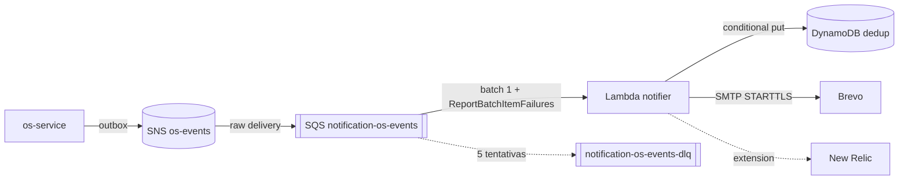

# postech-tc4-notification-lambda

Notificação serverless da oficina: avisa o cliente por e-mail a cada mudança de status da Ordem de Serviço.



## O que faz
- Consome `os.ServiceOrderStatusChanged` (envelope de `pkg/contracts`, cópia do contrato canônico do os-service).
- Um e-mail por status: aberta, em diagnóstico, orçamento pronto (com o valor), aguardando pagamento (com o link do Mercado Pago), em execução, finalizada, entregue e cancelada (com o motivo). `awaiting_budget` é etapa interna e não gera e-mail.
- **Idempotente:** reserva o `message_id` no DynamoDB com escrita condicional antes de enviar. Se o envio falha, libera a reserva para a próxima tentativa enviar.
- **Falha parcial de lote:** devolve só as mensagens que falharam (`ReportBatchItemFailures`). Mensagem inválida vai para a DLQ depois de 5 tentativas.
- **Observabilidade:** `nrlambda` com a layer `NewRelicLambdaExtensionARM64` e `batch_size = 1`. Cada invocação aceita os headers W3C/New Relic que viajam como MessageAttributes, e o trace continua o do os-service. Evento customizado `NotificationSent` para o dashboard.
- **LGPD:** e-mail e CPF aparecem mascarados nos logs (`a***@example.com`, `***.***.***-25`).

## Configuração
| Variável | Padrão | Descrição |
|---|---|---|
| `SMTP_HOST` / `SMTP_PORT` | `smtp-relay.brevo.com` / `587` | Servidor SMTP |
| `SMTP_USERNAME` / `SMTP_PASSWORD` | — | Credenciais Brevo (secrets) |
| `SMTP_FROM` / `SMTP_FROM_NAME` | `noreply@reservoirdevs.online` | Remetente |
| `DEDUP_TABLE` / `DEDUP_TTL` | `notification-dedup` / `168h` | Tabela de idempotência |
| `PORTAL_URL` | — | Link opcional no e-mail de orçamento |
| `NEW_RELIC_*` | — | Ver `infra/main.tf` |

## Desenvolvimento
```bash
make test                                            # unitários (SMTP falso em memória)
TEST_DYNAMODB_ENDPOINT=http://localhost:4566 make cover   # inclui DynamoDB no LocalStack
make lint
make package                                         # notifier.zip (arm64, provided.al2023)
```

## Deploy
`infra/` (Terraform): function com a LabRole, layer do New Relic, event source mapping na fila `notification-os-events` (criada no repositório de infra junto com o tópico e a DLQ) e a tabela de deduplicação com TTL.

```bash
cd infra
terraform init -backend-config=...
terraform apply -var-file=envs/prod.tfvars -var smtp_username=... -var smtp_password=...
```
