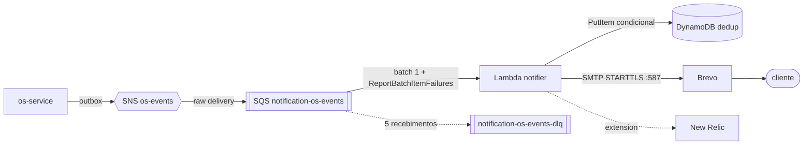
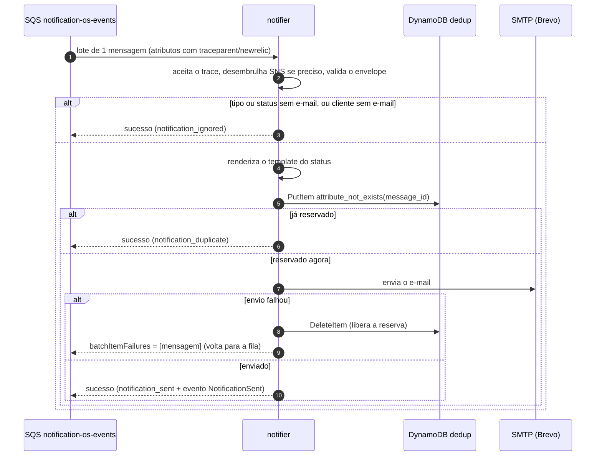

# postech-tc4-notification-lambda

**Notificação serverless** da oficina mecânica: uma function AWS Lambda que avisa o cliente por e-mail a cada mudança de status da ordem de serviço (OS). Consome o evento `os.ServiceOrderStatusChanged` que o [os-service](https://github.com/Kc1t/postech-tc4-os-service) publica pelo outbox no tópico `os-events`, lido pela fila `notification-os-events`, e envia o e-mail por SMTP (Brevo). A escolha de uma Lambda para a notificação está na [ADR-0022](https://github.com/Kc1t/postech-tc4-os-service/blob/main/docs/adr/0022-notificacao-por-lambda.md).

Tech Challenge Fase 4, FIAP Pós Tech SOAT. Go 1.26 em AWS Lambda (`provided.al2023`, arm64), SQS, DynamoDB (deduplicação), SMTP com STARTTLS, New Relic (`nrlambda` e a layer da extension), logs JSON (`log/slog`), Terraform e GitHub Actions.

| Repositório | Papel | Banco |
|---|---|---|
| [postech-tc4-os-service](https://github.com/Kc1t/postech-tc4-os-service) | OS, clientes, veículos, catálogo e estoque; orquestrador da saga | PostgreSQL (RDS) |
| [postech-tc4-billing-service](https://github.com/Kc1t/postech-tc4-billing-service) | orçamento e pagamento com Mercado Pago | PostgreSQL (RDS) |
| [postech-tc4-execution-service](https://github.com/Kc1t/postech-tc4-execution-service) | fila de diagnóstico e reparo da oficina | DynamoDB |
| **postech-tc4-notification-lambda** (este) | e-mail ao cliente a cada mudança de status da OS | DynamoDB (deduplicação) |
| [postech-tc4-lambda-auth](https://github.com/Kc1t/postech-tc4-lambda-auth) | CPF → JWT e authorizer do API Gateway | (consulta o os-service) |
| [postech-tc4-infra-k8s](https://github.com/Kc1t/postech-tc4-infra-k8s) | EKS, API Gateway, SNS/SQS/DLQ, observabilidade, e2e local | — |

## Guia rápido para avaliação

| Entregável da fase 4 | Onde está |
|---|---|
| Código-fonte | `cmd/notifier`, `internal/` e `pkg/contracts` ([Arquitetura](#arquitetura)) |
| Empacotamento e infraestrutura | zip com o binário `bootstrap` (`make package`) e Terraform da function, do event source mapping e da tabela de deduplicação em [`infra/`](infra/). Não há Dockerfile nem manifesto Kubernetes: a function roda no runtime `provided.al2023` |
| Banco próprio | tabela DynamoDB `postech-tc4-prod-notifier-dedup` ([Banco e modelo de dados](#banco-e-modelo-de-dados)) |
| Pipeline de CI/CD | [`.github/workflows/ci.yml`](.github/workflows/ci.yml) |
| Evidência de cobertura | **92,0%** no `go test` e **92,7%** no SonarQube, publicados no resumo de cada [execução do CI](https://github.com/Kc1t/postech-tc4-notification-lambda/actions/workflows/ci.yml) ([Testes](#testes-e-evidência-de-cobertura)) |
| Documentação da arquitetura do serviço | este README, de [Responsabilidades](#responsabilidades) a [Decisões e limitações](#decisões-e-limitações) |
| Contrato | a function não tem API HTTP: o contrato é a mensagem consumida ([Mensagem consumida](#mensagem-consumida-fila-notification-os-events)), com JSON Schema em [`pkg/contracts/schemas`](pkg/contracts/schemas/os.ServiceOrderStatusChanged.schema.json) e no [AsyncAPI do os-service](https://github.com/Kc1t/postech-tc4-os-service/blob/main/docs/asyncapi/asyncapi.yaml) |

## Responsabilidades

| Faz | Não faz |
|---|---|
| Consome `os.ServiceOrderStatusChanged` da fila `notification-os-events` | Decidir quando a OS muda de status (é do os-service e da saga) |
| Monta um e-mail por status (HTML e texto), com valor do orçamento, link do Mercado Pago e motivo do cancelamento quando houver | Gerar o link de pagamento ou calcular o valor (vêm no evento) |
| Envia por SMTP com STARTTLS e autenticação | Guardar dados do cliente: nome e e-mail vêm no evento |
| Garante no máximo um e-mail por mensagem (deduplicação por `message_id` no DynamoDB) | Reenviar e-mail que já saiu |
| Devolve à fila só a mensagem que falhou (`ReportBatchItemFailures`) | Participar da saga: não publica eventos, e uma falha de e-mail não compensa a OS |

## Arquitetura





| Pasta | Conteúdo |
|---|---|
| `cmd/notifier` | `main`: configuração por variáveis de ambiente, logger e start com ou sem New Relic |
| `internal/notifier` | handler do lote SQS: trace, validação, filtro, deduplicação, envio e resposta parcial |
| `internal/templates` | assunto e corpo de cada status, layout HTML (`html/layout.html`) e formatação de dinheiro |
| `internal/mail` | cliente SMTP (STARTTLS, `PLAIN`, MIME com HTML e texto) |
| `internal/idempotency` | reserva e liberação do `message_id` no DynamoDB |
| `internal/mask` | mascaramento de e-mail e CPF nos logs (LGPD) |
| `pkg/contracts` | envelope e JSON Schemas das mensagens, cópia idêntica à dos serviços |
| `infra/` | Terraform da function, do event source mapping, da tabela e do log group |

## Comunicação

| Canal | Direção | Nome |
|---|---|---|
| SQS | consome | fila `notification-os-events`, assinada no tópico `os-events` com raw delivery (DLQ `notification-os-events-dlq` depois de 5 recebimentos, visibilidade de 180 s, 6 vezes o timeout da function) |
| SMTP | saída | `smtp-relay.brevo.com:587` com STARTTLS |
| DynamoDB | saída | tabela de deduplicação |

A function não tem rota HTTP, não publica mensagens e não chama nenhum outro serviço.

### Mensagem consumida (fila `notification-os-events`)

Envelope de `pkg/contracts` (`message_id`, `type`, `version`, `saga_id`, `os_id`, `correlation_id`, `producer`, `occurred_at`, `payload`) com o tipo `os.ServiceOrderStatusChanged`, publicado pelo os-service a cada mudança de status da OS. Payload:

| Campo | Uso |
|---|---|
| `os_code` | número da OS no assunto e no corpo |
| `status`, `previous_status` | escolhe o template |
| `requester` (`id`, `name`, `email`, `document`) | destinatário; o CPF só aparece mascarado no log |
| `total_amount` | valor do orçamento (`awaiting_approval`, `awaiting_payment`) |
| `checkout_url` | link do Mercado Pago (`awaiting_payment`) |
| `reason` | motivo do cancelamento (`cancelled`) |

O JSON Schema com três exemplos está em [`pkg/contracts/schemas/os.ServiceOrderStatusChanged.schema.json`](pkg/contracts/schemas/os.ServiceOrderStatusChanged.schema.json). Os 23 tipos de mensagem do sistema (7 comandos e 16 eventos) estão no [AsyncAPI do os-service](https://github.com/Kc1t/postech-tc4-os-service/blob/main/docs/asyncapi/asyncapi.yaml).

### E-mail por status

| Status | Assunto |
|---|---|
| `received` | `OS #<código> aberta` |
| `in_diagnosis` | `OS #<código> em diagnóstico` |
| `awaiting_approval` | `Orçamento da OS #<código>: R$ <valor>` (com o link do portal se `PORTAL_URL` estiver definida) |
| `awaiting_payment` | `Pagamento da OS #<código>` (com o link do Mercado Pago, quando já veio no evento) |
| `in_execution` | `Pagamento confirmado: OS #<código> em execução` |
| `finished` | `OS #<código> finalizada` |
| `delivered` | `OS #<código> entregue` |
| `cancelled` | `OS #<código> cancelada` (com o motivo e o aviso de estorno automático) |

`awaiting_budget` é etapa interna (o orçamento ainda está sendo gerado) e não gera e-mail. O caminho feliz completo gera 7 e-mails, como o e2e do infra-k8s confere no Mailpit.

### Garantias de entrega

- **No máximo um e-mail por mensagem**: antes de enviar, a function reserva o `message_id` com `PutItem` e `attribute_not_exists(message_id)`. Reentrega do SQS encontra a reserva e não reenvia (`notification_duplicate`). Se o envio falha, a reserva é apagada para a próxima tentativa poder enviar.
- **Falha parcial de lote**: o handler devolve em `batchItemFailures` só a mensagem que falhou; o resto do lote é confirmado. Com `batch_size = 1`, cada invocação tem uma mensagem e um trace.
- **Falha permanente vai para a DLQ**: envelope ou payload inválido devolve erro (`notification_invalid_message`, `notification_invalid_payload`), e depois de 5 recebimentos a mensagem vai para `notification-os-events-dlq`, que guarda 14 dias para análise e redrive. Falha de SMTP, de template ou de DynamoDB também volta para a fila e, se persistir, termina na DLQ.
- **Mensagem sem e-mail a enviar é confirmada**: tipo diferente de `os.ServiceOrderStatusChanged`, status sem template ou cliente sem e-mail geram `notification_ignored` e não voltam para a fila.
- **Concorrência limitada**: o event source mapping usa no máximo 5 execuções simultâneas.
- **Corpo SNS**: a assinatura usa raw delivery, mas o handler também aceita o corpo no formato de notificação SNS (`unwrapSNS`), para o caso de a assinatura ser recriada sem raw delivery.

## Banco e modelo de dados

Tabela DynamoDB `postech-tc4-prod-notifier-dedup`, criada pelo Terraform em [`infra/`](infra/): `PAY_PER_REQUEST`, chave `message_id`, TTL no atributo `expires_at`, point-in-time recovery e criptografia em repouso. Só a function usa esta tabela.

| Atributo | Tipo | Conteúdo |
|---|---|---|
| `message_id` (chave) | S | `message_id` do envelope |
| `claimed_at` | S | quando a mensagem foi reservada (RFC 3339) |
| `expires_at` | N | epoch em que o TTL remove o item (`DEDUP_TTL`, padrão 7 dias, mais que os 4 dias de retenção da fila) |

Por que DynamoDB: o único acesso é "este `message_id` já foi tratado?", resolvido com uma escrita condicional por chave, sem servidor para administrar e com TTL nativo para limpar os itens antigos.

## Segurança

- **Sem API pública**: a function só é acionada pelo event source mapping da fila; não tem URL nem rota no API Gateway.
- **SMTP cifrado**: o cliente faz STARTTLS (TLS 1.2 ou mais) antes de autenticar; sem STARTTLS, o `net/smtp` só autentica em `localhost`.
- **Segredos**: `SMTP_USERNAME` e `SMTP_PASSWORD` vêm dos GitHub Secrets e chegam à function por variável de ambiente, pelo Terraform. A execution role é a `LabRole` (o Learner Lab não permite criar IAM).
- **Dados pessoais**: e-mail e CPF aparecem mascarados nos logs (`a***@example.com`, `***.***.***-25`); o corpo do e-mail não entra no log.
- **Conteúdo do e-mail**: o HTML é montado com `html/template`, que escapa os dados do evento (nome do cliente, motivo).

## Observabilidade

New Relic por `nrlambda` com a layer `NewRelicLambdaExtensionARM64`, que envia traces e logs (`NEW_RELIC_EXTENSION_SEND_FUNCTION_LOGS=true`). Com `NEW_RELIC_APM_LAMBDA_MODE=true`, as invocações chegam como `Transaction`. Sem a licença, o Terraform não instala a layer e a function sobe com `lambda.Start` puro.

- **Trace distribuído**: a invocação aceita os headers `traceparent`, `tracestate` e `newrelic` que viajam como atributos da mensagem, então o trace continua o da requisição que mudou a OS no os-service.
- **Erros**: uma mensagem que falha volta para a fila e marca erro na transação (`NoticeError`), então entra na taxa de erro da function e no Errors Inbox.
- **Logs em contexto**: JSON com o texto em `message` e `trace.id`, `span.id` e `entity.guid`; cada linha traz `sqs_message_id` e, depois do parse, `message_id`, `message_type`, `saga_id`, `os_id`, `service_order_code` e `status`.
- **Evento customizado** `NotificationSent` (`status`, `serviceOrderCode`, `messageId`), usado no dashboard.

| Log | Significado |
|---|---|
| `notification_sent` | e-mail enviado (`to` mascarado, `subject`) |
| `notification_ignored` | tipo não notificado, status sem e-mail ou cliente sem e-mail (`reason`) |
| `notification_duplicate` | mensagem já tratada |
| `notification_invalid_message`, `notification_invalid_payload` | envelope ou payload fora do contrato |
| `notification_render_failed`, `notification_dedup_failed`, `notification_send_failed`, `notification_release_failed` | falhas de template, DynamoDB, SMTP e liberação da reserva |

Alertas que cobrem a function (Terraform em [postech-tc4-infra-k8s/observability](https://github.com/Kc1t/postech-tc4-infra-k8s/tree/main/observability), cada um com runbook em [`docs/runbooks`](https://github.com/Kc1t/postech-tc4-infra-k8s/tree/main/docs/runbooks)):

| Alerta | Condição |
|---|---|
| `lambda notifier: falhas de envio de e-mail acima de 4 em 5 min` | `notification_send_failed`, `notification_dedup_failed` e `notification_render_failed`; aviso a partir da primeira |
| `lambda notifier: taxa de erro acima de 5% em 5 min` | invocações com erro sobre o total |
| `mensageria: mensagem malformada recebida em 5 min` | inclui `notification_invalid_message` e `notification_invalid_payload` |
| alarme CloudWatch `postech-tc4-prod-dlq-notification-os-events` | qualquer mensagem visível na DLQ |

## Configuração

| Variável | Padrão no código | No Terraform | Descrição |
|---|---|---|---|
| `SMTP_HOST` | — | `smtp-relay.brevo.com` | servidor SMTP |
| `SMTP_PORT` | `587` | `587` | porta SMTP |
| `SMTP_USERNAME` / `SMTP_PASSWORD` | — | GitHub Secrets | credenciais do Brevo |
| `SMTP_FROM` | `noreply@reservoirdevs.online` | variável `SMTP_FROM` do repositório, se definida | remetente verificado no Brevo |
| `SMTP_FROM_NAME` | `Oficina Reservoir Devs` | — | nome do remetente |
| `SMTP_TIMEOUT` | `10s` | — | timeout da conversa SMTP |
| `DEDUP_TABLE` | `notification-dedup` | `postech-tc4-prod-notifier-dedup` | tabela de deduplicação |
| `DEDUP_TTL` | `168h` | — | validade da reserva |
| `PORTAL_URL` | — | variável `PORTAL_URL` do repositório, se definida | link do portal do cliente no e-mail de orçamento |
| `LOG_LEVEL` | `info` | `info` | nível do log |
| `NEW_RELIC_*` | — | definidas quando há licença | ver [`infra/main.tf`](infra/main.tf) |

## Como rodar localmente

```bash
make test                                                   # unidade (SMTP falso em memória)
docker run -d --name ls-notifier -p 4566:4566 -e SERVICES=dynamodb localstack/localstack:3.8
TEST_DYNAMODB_ENDPOINT=http://localhost:4566 AWS_REGION=us-east-1 \
  AWS_ACCESS_KEY_ID=test AWS_SECRET_ACCESS_KEY=test go test ./internal/... ./pkg/... -cover
make lint
make package                                                # notifier.zip (bootstrap linux/arm64)
```

Sem `TEST_DYNAMODB_ENDPOINT`, o teste da tabela de deduplicação contra o LocalStack é pulado e só o teste de unidade da store roda.

Para ver os e-mails de verdade, use o ambiente e2e do [postech-tc4-infra-k8s/local](https://github.com/Kc1t/postech-tc4-infra-k8s/tree/main/local): `make up lambdas` publica o notifier no LocalStack ligado à fila `notification-os-events`, com SMTP apontando para o Mailpit (`http://localhost:8026`), e o `make e2e` confere os 7 e-mails do caminho feliz.

## Testes e evidência de cobertura

| Pacote | Cobertura | O que cobre |
|---|---|---|
| `internal/notifier` | 94,4% | envio e filtro por status, mensagem duplicada que não reenvia, falha que marca erro e loga com trace, falha parcial do lote (`ReportBatchItemFailures`), invólucro do SNS e o **teste de contrato**: os exemplos do JSON Schema de `os.ServiceOrderStatusChanged` passam pelo handler e geram o assunto esperado |
| `internal/idempotency` | 100% | reserva condicional, duplicata, liberação da reserva, TTL e erro da API; contra o DynamoDB do LocalStack quando `TEST_DYNAMODB_ENDPOINT` existe |
| `internal/templates` | 87,8% | um e-mail por status, link do Mercado Pago, motivo do cancelamento e formatação de dinheiro |
| `internal/mail` | 86,6% | montagem MIME e envio contra um SMTP falso, com os erros de cada etapa |
| `internal/mask` | 100% | mascaramento de e-mail e CPF |
| `pkg/contracts` | 93,5% | envelope e JSON Schemas, cópia idêntica à dos serviços (`make contracts` no e2e confere) |
| **Total (`internal/` e `pkg/`)** | **92,0%** | |

O número é o do CI (`go test ./internal/... ./pkg/...` com o DynamoDB do LocalStack). O `make cover` mede os mesmos pacotes; sem `TEST_DYNAMODB_ENDPOINT` apontando para um LocalStack, o teste da idempotência é pulado e o total local fica em 91,3%.

**Evidência de cobertura:** **92,0%** no `go test` e **92,7%** no SonarQube, com o quality gate aprovado (0 bugs, 0 vulnerabilidades, 0 code smells, 0% de duplicação). Cada execução do [CI](https://github.com/Kc1t/postech-tc4-notification-lambda/actions/workflows/ci.yml) publica no resumo do job a cobertura e a tabela do SonarQube; o pipeline reprova abaixo de 80%.

## CI/CD e deploy

Pipeline próprio em [`.github/workflows/ci.yml`](.github/workflows/ci.yml), em PR e push.

| Job | O que faz |
|---|---|
| Lint, SAST e testes | `go mod tidy` limpo, `gofmt`, `go vet`, golangci-lint, gosec, DynamoDB do LocalStack, testes com race, **cobertura mínima de 80%** e govulncheck |
| SonarQube (quality gate) | SonarQube Community num container do job, com quality gate próprio (cobertura ≥ 80%, duplicação ≤ 3%, nota A em confiabilidade, segurança e manutenibilidade), cobertura e relatórios do golangci-lint e do gosec ([`.github/scripts/sonar.sh`](.github/scripts/sonar.sh)) |
| Terraform (fmt, validate, tfsec) | `fmt -check`, `validate` e tfsec (exceções justificadas no `main.tf`: Learner Lab sem CMK, trace pelo New Relic em vez do X-Ray) |
| Deploy | só em push na `main` com `AWS_DEPLOY_ENABLED=true`: `make package`, `terraform apply` (state `notification-lambda/prod.tfstate`) e smoke test com um lote vazio (`{"Records":[]}`), que exercita o bootstrap, a extension do New Relic e o handler sem mandar e-mail |

A `main` é protegida: só recebe PR, com a branch atualizada, conversas resolvidas e os três primeiros jobs obrigatórios, inclusive para administradores. O deploy depende da variável `AWS_DEPLOY_ENABLED=true` porque as credenciais do Learner Lab expiram a cada sessão.

Secrets: `AWS_ACCESS_KEY_ID`, `AWS_SECRET_ACCESS_KEY`, `AWS_SESSION_TOKEN`, `TF_STATE_BUCKET`, `SMTP_USERNAME`, `SMTP_PASSWORD` e `NEW_RELIC_LICENSE_KEY`. Variáveis: `AWS_REGION`, `SMTP_FROM`, `PORTAL_URL` (opcional) e `NEW_RELIC_ACCOUNT_ID`. O [`scripts/setup-github.sh`](https://github.com/Kc1t/postech-tc4-infra-k8s/blob/main/scripts/setup-github.sh) do infra-k8s grava as credenciais AWS, o bucket de state, a licença do New Relic e, no comando `smtp`, `SMTP_USERNAME`, `SMTP_PASSWORD` e `SMTP_FROM`. O `PORTAL_URL` não é gravado pelo script: sem ele, o e-mail de orçamento sai sem o link do portal (`gh variable set PORTAL_URL --repo Kc1t/postech-tc4-notification-lambda --body <url>` para definir).

O Terraform cria a function `postech-tc4-prod-notifier` (128 MB, 30 s, arm64, `LabRole`), o log group de 14 dias, a tabela de deduplicação e o event source mapping na fila `notification-os-events` (`batch_size = 1`, `ReportBatchItemFailures`, concorrência máxima 5). A fila, a DLQ e a assinatura no tópico `os-events` são criadas pelo [postech-tc4-infra-k8s](https://github.com/Kc1t/postech-tc4-infra-k8s/blob/main/messaging.tf), que precisa ser aplicado antes.

## Decisões e limitações

- **Lambda com fila própria** ([ADR-0022](https://github.com/Kc1t/postech-tc4-os-service/blob/main/docs/adr/0022-notificacao-por-lambda.md)): o consumo é esporádico e cobrado por invocação, em vez de um deployment sempre ligado, e a fila transforma um SMTP fora do ar em mensagem esperando, não em e-mail perdido. A ADR registra as alternativas descartadas (SMTP no pod, SES, Lambda assinando o SNS direto, assinatura de e-mail do SNS, quarto microsserviço).
- **Fora da VPC** ([ADR-0014](https://github.com/Kc1t/postech-tc4-os-service/blob/main/docs/adr/0014-lambdas-fora-da-vpc.md)): precisa de internet para o SMTP e para a extension do New Relic, e não acessa nenhum recurso privado.
- **Reserva antes do envio**: se a function cair depois de enviar e antes de responder ao SQS, a reentrega encontra a reserva e não duplica o e-mail; se o SMTP recusar, a reserva é liberada e a mensagem volta. Os dois casos raros que sobram: um timeout do SMTP depois de o servidor já ter aceitado a mensagem libera a reserva e pode gerar um segundo e-mail, e uma interrupção da function entre a reserva e o envio deixa a mensagem reservada sem e-mail até o TTL.
- **E-mail não compensa a saga**: a notificação é efeito colateral; uma falha aqui não muda o status da OS. A cobertura de falha é pelos alertas do notifier, pela DLQ e pelo alarme do CloudWatch.
- **Deduplicação por `message_id`**: duas mudanças de status diferentes geram dois `message_id` e dois e-mails, como esperado; a mesma mudança reentregue gera um só.
