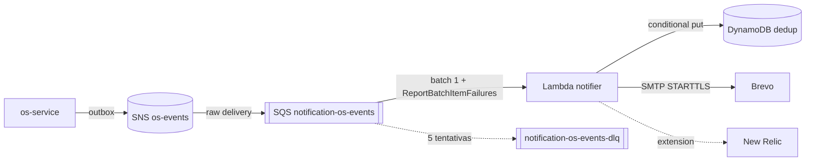

# postech-tc4-notification-lambda

Notificação serverless da oficina: avisa o cliente por e-mail a cada mudança de status da Ordem de Serviço.



## O que faz
- Consome `os.ServiceOrderStatusChanged` (envelope de `pkg/contracts`, cópia do contrato canônico do os-service).
- Um e-mail por status: aberta, em diagnóstico, orçamento pronto (com o valor), aguardando pagamento (com o link do Mercado Pago), em execução, finalizada, entregue e cancelada (com o motivo). `awaiting_budget` é etapa interna e não gera e-mail.
- **Idempotente:** reserva o `message_id` no DynamoDB com escrita condicional antes de enviar. Se o envio falha, libera a reserva para a próxima tentativa enviar.
- **Falha parcial de lote:** devolve só as mensagens que falharam (`ReportBatchItemFailures`). Mensagem inválida vai para a DLQ depois de 5 tentativas.
- **Observabilidade:** `nrlambda` com a layer `NewRelicLambdaExtensionARM64` e `batch_size = 1`. Cada invocação aceita os headers W3C/New Relic que viajam como MessageAttributes, e o trace continua o do os-service. Evento customizado `NotificationSent` para o dashboard.
- **LGPD:** e-mail e CPF aparecem mascarados nos logs (`a***@example.com`, `***.***.***-25`).

## Configuração
| Variável | Padrão | Descrição |
|---|---|---|
| `SMTP_HOST` / `SMTP_PORT` | `smtp-relay.brevo.com` / `587` | Servidor SMTP |
| `SMTP_USERNAME` / `SMTP_PASSWORD` | — | Credenciais Brevo (secrets) |
| `SMTP_FROM` / `SMTP_FROM_NAME` | `noreply@reservoirdevs.online` | Remetente |
| `DEDUP_TABLE` / `DEDUP_TTL` | `notification-dedup` / `168h` | Tabela de idempotência |
| `PORTAL_URL` | — | Link opcional no e-mail de orçamento |
| `NEW_RELIC_*` | — | Ver `infra/main.tf` |

## Desenvolvimento
```bash
make test                                            # unitários (SMTP falso em memória)
TEST_DYNAMODB_ENDPOINT=http://localhost:4566 make cover   # inclui DynamoDB no LocalStack
make lint
make package                                         # notifier.zip (arm64, provided.al2023)
```

## Testes

| Pacote | Cobertura | O que cobre |
|---|---|---|
| `internal/notifier` | 95,2% | envio e filtro por status, mensagem duplicada que não reenvia, falha parcial do lote (`ReportBatchItemFailures`), invólucro do SNS e o **teste de contrato**: os exemplos do JSON Schema de `os.ServiceOrderStatusChanged` passam pelo handler e geram o assunto esperado |
| `internal/idempotency` | 100% | reserva condicional, duplicata, liberação da reserva, TTL e erro da API; contra o DynamoDB do LocalStack quando `TEST_DYNAMODB_ENDPOINT` existe |
| `internal/templates` | 87,8% | um e-mail por status, link do Mercado Pago, motivo do cancelamento e formatação de dinheiro |
| `internal/mail` | 86,6% | montagem MIME e envio contra um SMTP falso, com os erros de cada etapa |
| `internal/mask` | 100% | mascaramento de e-mail e CPF |
| `pkg/contracts` | 93,5% | envelope e JSON Schemas, cópia idêntica à dos serviços (`make contracts` no e2e confere) |
| **Total** | **92,1%** | |

## CI/CD

Pipeline próprio em [`.github/workflows/ci.yml`](.github/workflows/ci.yml). A `main` é protegida: só recebe PR, com os três primeiros jobs obrigatórios.

| Job | O que faz |
|---|---|
| Lint, SAST e testes | `go mod tidy` limpo, `gofmt`, `go vet`, golangci-lint, gosec, DynamoDB do LocalStack, testes com race, **cobertura mínima de 80%** e govulncheck |
| SonarQube | SonarQube Community num container do job, com quality gate próprio (cobertura ≥ 80%, duplicação ≤ 3%, nota A em confiabilidade, segurança e manutenibilidade), cobertura e relatórios do golangci-lint e do gosec ([`.github/scripts/sonar.sh`](.github/scripts/sonar.sh)) |
| Terraform | `fmt -check`, `validate` e tfsec (exceções justificadas no `main.tf`: Learner Lab sem CMK, trace pelo New Relic em vez do X-Ray) |
| Deploy (push na `main`) | `make package`, `terraform apply` e smoke test com um lote vazio (`{"Records":[]}`), que exercita o bootstrap, a extension do New Relic e o handler sem mandar e-mail |

O deploy só roda com `AWS_DEPLOY_ENABLED=true`, porque as credenciais do Learner Lab expiram a cada sessão. Secrets: `AWS_*`, `TF_STATE_BUCKET`, `SMTP_USERNAME`, `SMTP_PASSWORD` e `NEW_RELIC_LICENSE_KEY`; variáveis: `AWS_REGION`, `SMTP_FROM`, `PORTAL_URL` e `NEW_RELIC_ACCOUNT_ID` (todas gravadas pelo `scripts/setup-github.sh` do infra-k8s).

**Evidência de cobertura:** 92,1% nos testes do CI e 89,2% no SonarQube, com o quality gate aprovado (0 bugs, 0 vulnerabilidades, 0 code smells, 0% de duplicação). Cada execução publica a cobertura no resumo do job.

## Deploy
`infra/` (Terraform): function com a LabRole, layer do New Relic, event source mapping na fila `notification-os-events` (criada no repositório de infra junto com o tópico e a DLQ) e a tabela de deduplicação com TTL.

```bash
cd infra
terraform init -backend-config=...
terraform apply -var-file=envs/prod.tfvars -var smtp_username=... -var smtp_password=...
```
